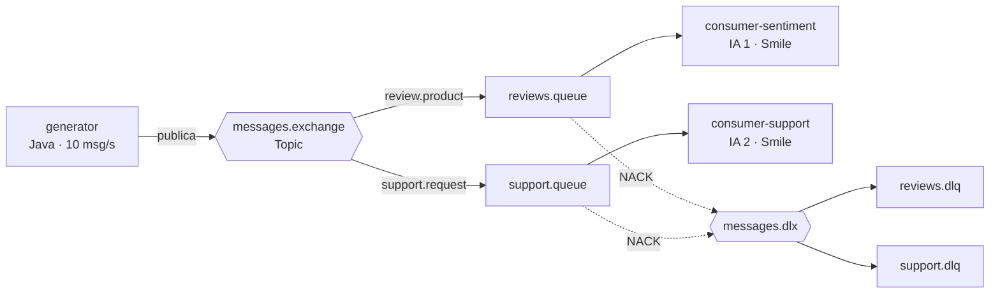
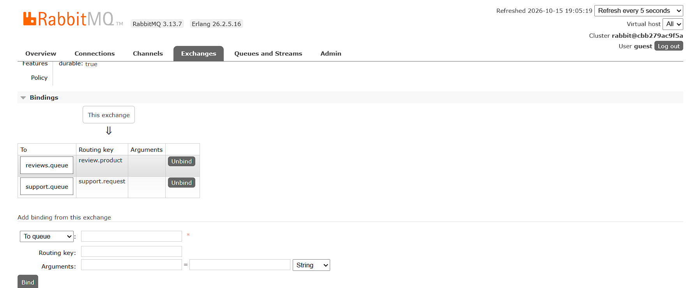
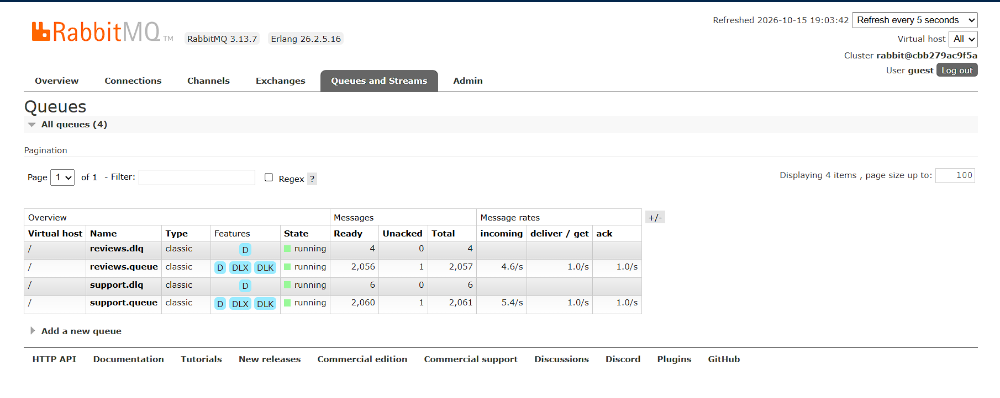

# Classificação Inteligente de Mensagens com RabbitMQ

Atividade 5 — Sistemas Distribuídos (UFPI). Sistema distribuído em **Java, Docker, RabbitMQ e IA** que gera, distribui e classifica mensagens automaticamente por meio de dois consumidores independentes.

## Arquitetura



| Container | Função |
|---|---|
| `generator` | Gera avaliações de produtos e solicitações de suporte (≥ 5 msg/s) e publica com a routing key do tipo. |
| `rabbitmq` | Topic Exchange, uma fila por consumidor, DLQs e interface de administração (porta 15672). |
| `consumer-sentiment` | Classifica avaliações em **positiva**, **negativa** ou **neutra**. |
| `consumer-support` | Classifica solicitações em **problema de acesso**, **desempenho** ou **conexão**. |

**Formato da mensagem (JSON):** `id` (UUID), `timestamp` (ISO-8601), `type` (`review` ou `support`), `content`.

## Estrutura do repositório

```
├── docker-compose.yml
├── generator/            # Dockerfile, pom.xml, código-fonte
├── consumer-sentiment/   # Dockerfile, pom.xml, código-fonte, treino_sentimento.csv
├── consumer-support/     # Dockerfile, pom.xml, código-fonte, treino_suporte.csv
└── docs/evidencias/      # capturas da execução
```

## Como executar

Requisito: Docker com Docker Compose.

```bash
docker compose up --build -d      # sobe os 4 containers em segundo plano
docker compose logs -f generator  # ou consumer-sentiment / consumer-support
docker compose down               # encerra
```

Interface do RabbitMQ: <http://localhost:15672> (usuário `guest`, senha `guest`) → aba **Queues**.

Variáveis ajustáveis no `docker-compose.yml`: `MESSAGES_PER_SECOND`, `ERROR_EVERY`, `PROCESSING_DELAY_MS`, `PREFETCH`.

## Requisitos atendidos

- **Topic Exchange** `messages.exchange` com routing keys `review.product` e `support.request`.
- **Uma fila por consumidor:** `reviews.queue` e `support.queue`.
- **Filas crescendo:** chegada ≈ 5 msg/s por fila contra ≈ 1 msg/s de consumo (`PROCESSING_DELAY_MS=1000`, `PREFETCH=1`).
- **Manual ACK:** `autoAck=false`; o `basicAck` só ocorre depois da classificação.
- **DLQ:** erro de processamento → `basicNack(requeue=false)` → `messages.dlx` → `reviews.dlq` / `support.dlq`.
- **Docker Compose:** 4 containers na mesma rede (`app-net`).

## As IAs

Cada consumidor possui seu próprio modelo, treinado na inicialização a partir de um CSV em `src/main/resources`.

- **Algoritmo:** regressão logística multinomial (`smile.classification.LogisticRegression`, biblioteca **Smile**).
- **Features:** bag-of-words binário (minúsculas, sem acentos, tokens com 3+ letras).
- **IA 1:** `treino_sentimento.csv` — 45 exemplos, 3 classes.
- **IA 2:** `treino_suporte.csv` — 34 exemplos, 3 classes.

## Demonstração

1. **Geração contínua:** `docker compose logs -f generator`.
2. **Roteamento:** RabbitMQ → *Exchanges* → `messages.exchange` → bindings; cada consumidor recebe só o seu tipo.
3. **Classificação:** logs dos consumidores (`... => POSITIVA`, `... => PROBLEMA DE CONEXÃO`).
4. **Crescimento das filas:** RabbitMQ → *Queues* (colunas Ready/Total).
5. **DLQ:** a cada 100 mensagens o gerador publica uma inválida (`mensagem-corrompida-N`); o consumidor registra o erro e a mensagem aparece em `reviews.dlq` ou `support.dlq` (*Get messages*).

## Evidências

| Filas crescendo | Bindings do exchange | Mensagem na DLQ |
|---|---|---|
|  |  |  |
